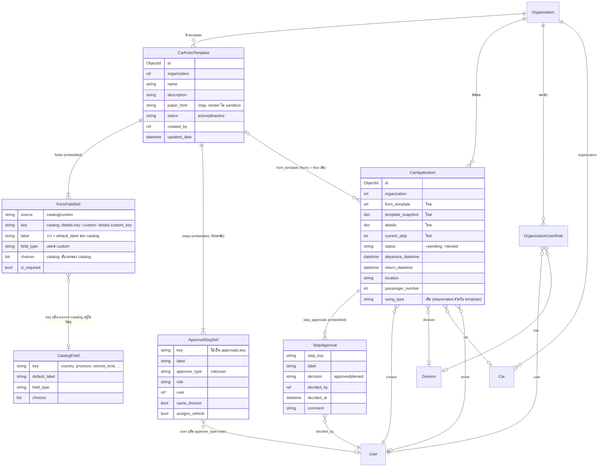
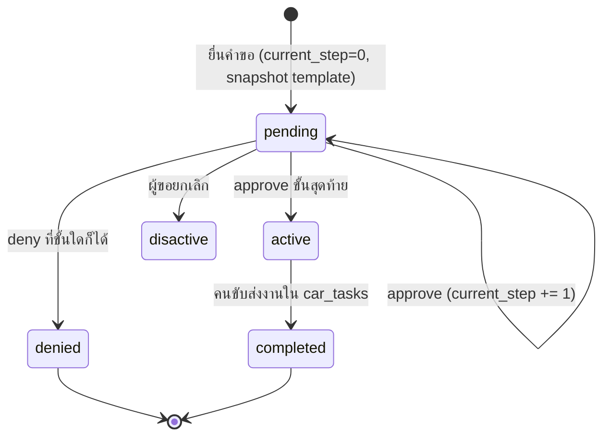

# POC: Car Form Template (custom fields + custom flow + custom paper)

## Context

ระบบขอใช้รถตอนนี้ผูกกับฟอร์ม DIIS ฟอร์มเดียว มีหน้ากระดาษตายตัว (`car_applications/paper.html`) และ flow ตายตัว header → admin → (director ถ้าไปต่างจังหวัด) ใน `car_permissions.py` ส่วนกองกายภาพและสิ่งแวดล้อมจะเป็น org แยก ใช้ฟอร์มและ flow ของตัวเอง (`flows/*.png`)

ผู้ใช้ต้องการให้ admin ของ org **สร้างและแก้ "template ใบขอใช้รถ" ได้เอง** คล้าย `email_templates` โดย template หนึ่งประกอบด้วย
1. **ฟิลด์** แบ่งเป็น 3 ระดับ: ฟิลด์กลาง (ล็อก), ฟิลด์จาก catalog (เลือกใส่ได้) และฟิลด์ custom (ตั้งเองอิสระ) ดูข้อ 1.1
2. **flow อนุมัติ** ที่กำหนดเองได้
3. **หน้ากระดาษ** ที่เป็น Jinja HTML แก้ได้

**POC นี้ต้องพิสูจน์ว่า:** template 2 ตัวจาก 2 org ที่มีฟิลด์ flow และกระดาษต่างกัน ทำงานได้ครบตั้งแต่ยื่นคำขอ → อนุมัติทีละขั้น → จัดรถ → พิมพ์ใบ โดย**ไม่แตะ flow เดิม** คำขอเก่าที่ไม่มี `form_template` ต้องเดินตาม flow เดิมทุกอย่าง

ทำบน branch `poc-car-application` ซึ่งเป็น branch ปัจจุบัน

## การตัดสินใจที่ได้ข้อสรุปแล้ว
- flow เป็นแบบ **linear** คือขั้นเรียงต่อกัน ไม่มีเงื่อนไขหรือการแตกกิ่ง ถ้าต้องการ flow ต่างไปให้สร้าง template ใหม่
- role: ผู้บังคับบัญชา = `head` (เห็นเฉพาะฝ่ายของตัวเอง), ผู้จัดรถบริการ = `admin`, ผอ.กอง = `director` (role นี้มีอยู่แล้ว)
- **ผู้อนุมัติ** ใน POC ระบุเป็น**ตัวคน** ส่วนจะ map กับ role ไหนยังเป็นคำถามค้าง
  → แต่ละขั้นจึงต้องเลือกได้ว่า `approver_type` เป็น `role` หรือ `user`
- อธิการบดีเซ็นบนกระดาษเท่านั้น ไม่ใช่ขั้นในระบบ
- คนขับไม่ใช่ขั้นอนุมัติ หลังผ่านทุกขั้นแล้วคำขอเป็น `active` แล้วไปจบที่ `car_tasks` ตามเดิม
- ปฏิเสธที่ขั้นไหนก็ได้ และคำขอจบทันที (ไม่มีการตีกลับไปแก้)
- ฟิลด์มี **3 ระดับ** (กลาง / catalog / custom) ฟิลด์จาก catalog และ custom เก็บใน `details` (DictField) ส่วน catalog ใช้ key มาตรฐานเดียวกันทุก org จึงทำรายงานข้าม org ได้

## Template ใน POC (seed ให้ 2 ตัว)
| template | org | ฟิลด์จาก catalog | ฟิลด์ custom | flow |
|---|---|---|---|---|
| DIIS ทั่วไป | DIIS | – | – | head → admin (จัดรถ) |
| ใบขอใช้รถยนต์ไปปฏิบัติงานภายในประเทศ | กองกายภาพ | `vehicle_kind`, `vehicle_count`, `district`, `province`, `cost_responsibility` | ตัวอย่าง 1 ฟิลด์ (text) เพื่อพิสูจน์ว่าใช้ custom ได้ | head → admin (จัดรถ) → ผู้อนุมัติ (ตัวคน) → director |

ทั้งสอง template มีฟิลด์กลางครบเสมอ

---

## 1. Models

### 1.1 ฟิลด์ 3 ระดับ

| ระดับ | ตัวอย่าง | ใครกำหนด | เก็บที่ | ใช้ทำรายงานหรือเชื่อมข้อมูล |
|---|---|---|---|---|
| **กลาง** (ทุกฟอร์มมี ลบไม่ได้) | วันเวลาไป/กลับ, สถานที่, จำนวนผู้โดยสาร, เบอร์โทร, เหตุผล, รถ, คนขับ | โค้ด | คอลัมน์บน `CarApplication` | ✅ ปฏิทิน, เช็กรถชน, เลขไมล์ |
| **Catalog** (เลือกใส่ในแต่ละฟอร์ม) | `country`, `city_state`, `province`, `district`, `vehicle_kind`, `vehicle_count`, `flight`, `passengers[]`, `cost_responsibility[]`, `coordinator`, `event_type`, `employee_type` | key, type, widget และ validation อยู่ในโค้ด ส่วน admin เลือกใช้ แก้ label, กำหนดบังคับกรอก, เรียงลำดับ และลดตัวเลือกที่ไม่ใช้ได้ | `details.<catalog_key>` | ✅ key เดียวกันทุก org |
| **Custom** (สำรองสำหรับกรณีพิเศษ) | "เลขที่โครงการ", "เลขที่หนังสือ" | admin (ใช้ได้แค่ type text, textarea, number, date, radio, checkbox) | `details.custom_<key>` | ❌ แสดงบนใบพิมพ์อย่างเดียว |

- **ฟิลด์ใหม่ที่ต้องใช้ทำรายงาน** ต้องเพิ่มเข้า catalog ในโค้ด (ครั้งเดียวแล้วทุก org ใช้ได้) ไม่ให้ใช้ custom แทน
- custom ใช้ prefix `custom_` เพื่อไม่ให้ key ชนกับ catalog ที่จะเพิ่มในอนาคต
- ฟอร์มทั้ง 4 ของกองกายภาพใช้ฟิลด์จาก catalog ได้ครบ ไม่ต้องใช้ custom

### 1.2 Field catalog: `kampan/utils/car_form_catalog.py` (ใหม่)

```python
@dataclass(frozen=True)
class CatalogField:
    key: str                   # คีย์มาตรฐาน เช่น "country"
    default_label: str         # "ประเทศ"
    field_type: str            # text | number | date | time | radio | checkbox | passengers | flight
    choices: tuple = ()        # ค่าตั้งต้น เช่น vehicle_kind = ("บัส","ตู้","เก๋ง","มินิบัส")
    build_wtf_field: Callable  # สร้าง WTForms field พร้อม validator
    to_display: Callable       # แปลงค่าเป็นข้อความ (ใช้ในใบพิมพ์และหน้าแสดงผล)

CATALOG: dict[str, CatalogField]
```

- **POC เตรียม catalog แค่ 5 ตัว:** `vehicle_kind` (radio), `vehicle_count` (number), `district` (text), `province` (text) และ `cost_responsibility` (checkbox) ส่วน `passengers` และ `flight` ที่เป็น widget ซับซ้อนยังไม่ทำในรอบนี้
- choices ที่ admin กำหนดใน template ต้องเป็นสับเซตของ choices ใน catalog เพื่อให้ค่าที่บันทึกเป็นมาตรฐานเดียวกัน

### 1.3 ใหม่: `kampan/models/car_form_templates.py`

ใช้รูปแบบเดียวกับ `QuestionTemplate` ใน `kampan/models/car_feedback.py`

```python
FIELD_SOURCES = [("catalog", "จาก catalog"), ("custom", "กำหนดเอง")]
CUSTOM_FIELD_TYPES = [("text",..), ("textarea",..), ("number",..), ("date",..),
                      ("radio",..), ("checkbox",..)]
APPROVER_TYPES = [("role", "ตาม role"), ("user", "ระบุตัวคน")]

class FormFieldDef(me.EmbeddedDocument):
    source = me.StringField(choices=FIELD_SOURCES, required=True, default="catalog")
    key = me.StringField(required=True, regex=r"^[a-z][a-z0-9_]*$")
        # catalog: ต้องเป็น key ใน CATALOG / custom: เก็บใน details เป็น "custom_<key>"
    label = me.StringField()                  # ถ้าว่าง ใช้ default_label ของ catalog
    field_type = me.StringField(choices=CUSTOM_FIELD_TYPES)  # ใช้เฉพาะ custom
    choices = me.ListField(me.StringField())  # custom: กำหนดเองได้ / catalog: ต้องเป็นสับเซต
    is_required = me.BooleanField(default=False)

    def details_key(self): return self.key if self.source == "catalog" else f"custom_{self.key}"

class ApprovalStepDef(me.EmbeddedDocument):
    key = me.StringField(required=True, regex=r"^[a-z][a-z0-9_]*$")  # ใช้อ้างในกระดาษ: approvals.<key>
    label = me.StringField(required=True)                            # เช่น "ผู้จัดรถบริการ"
    approver_type = me.StringField(choices=APPROVER_TYPES, default="role")
    role = me.StringField(choices=ORGANIZATION_ROLES)
    user = me.ReferenceField("User", dbref=True)
    same_division = me.BooleanField(default=False)   # สำหรับขั้น head
    assigns_vehicle = me.BooleanField(default=False) # ขั้นที่เลือกรถและคนขับ

class CarFormTemplate(me.Document):
    meta = {"collection": "car_form_templates", "indexes": ["organization"]}
    organization = me.ReferenceField("Organization", dbref=True, required=True)
    name, description
    fields = me.ListField(me.EmbeddedDocumentField(FormFieldDef))
    steps  = me.ListField(me.EmbeddedDocumentField(ApprovalStepDef))
    paper_html = me.StringField(default="")
    status = me.StringField(default="active", choices=[("active",..),("disactive",..)])
    created_by, last_updated_by, created_date, updated_date
    def clean(self): key ห้ามซ้ำ, catalog key ต้องมีอยู่ใน CATALOG, choices ของ catalog ต้องเป็นสับเซต,
                     custom ต้องมี field_type, ต้องมีอย่างน้อย 1 ขั้น, ขั้น assigns_vehicle ต้องมีพอดี 1 ขั้น,
                     ขั้น role ต้องมี role, ขั้น user ต้องมี user
```

### แก้: `kampan/models/vehicle_applications.py` → `CarApplication`

```python
form_template = me.ReferenceField("CarFormTemplate", dbref=True)  # None = flow เดิม
template_snapshot = me.DictField()   # สำเนา fields/steps/paper_html ตอนยื่น (ดูข้อ 6)
details = me.DictField(default=dict)
current_step = me.IntField(min_value=0, default=0)
step_approvals = me.ListField(me.EmbeddedDocumentField(StepApproval))
# StepApproval: step_key, label, decision ("approved"/"denied"), decided_by, decided_at, comment
```

- เพิ่ม `("pending", "รออนุมัติ")` และ `("denied", "ปฏิเสธ")` เข้า `CAR_APPLICATION_STATUS`
- เพิ่ม key เดียวกันใน color map ของ `get_status()` และใน `components/status_badge.html`

## 2. Flow engine: `kampan/utils/car_form_flow.py`

ฟังก์ชันล้วนที่ test ได้โดยไม่ต้องผ่าน request:

```python
current_step_def(app) -> dict | None
can_act(app, user, organization) -> bool
    # role: ผู้ใช้มี role นั้นใน org (current_user.get_organization_roles(org))
    #       และถ้า same_division=True ฝ่ายของผู้ใช้ต้องตรงกับ app.division
    # user: ผู้ใช้ต้องเป็นคนที่ระบุไว้
approve(app, user, comment="", car=None, driver=None)
    # ถ้าขั้นนี้ assigns_vehicle ต้องมี car (driver ไม่บังคับ)
    # บันทึก StepApproval แล้ว current_step += 1 ถ้าผ่านขั้นสุดท้ายแล้ว status = "active"
deny(app, user, reason) -> status = "denied", denied_reason = reason
pending_for(user, organization) -> QuerySet ของคำขอที่ผู้ใช้กดได้ (ใช้ในหน้า "รอฉันอนุมัติ")
```

- อ่าน steps จาก `app.template_snapshot` ไม่อ่านจาก template ตัวจริง
- เรื่องอีเมล: POC ส่งแค่ตอนคำขอเป็น `active` โดยเรียก `utils.send_email_to_drivers.force_send_email_to_driver` ตัวเดิม ส่วนอีเมลรายขั้นยังไม่ทำ (ดูคำถามค้าง)

## 3. Paper rendering: `kampan/utils/car_form_paper.py`

- ใช้ `jinja2.sandbox.SandboxedEnvironment(autoescape=True)` เพราะ admin เป็นคนเขียน HTML จึงต้องกัน SSTI ส่วน email template ตอนนี้ใช้ `Template` ตรงๆ เป็นช่องโหว่เดิมที่ไม่อยู่ในขอบเขต POC แต่จะบันทึกไว้
- ตัวแปรที่ส่งเข้า template:
  - `app`: ฟิลด์กลางที่จัดรูปแบบแล้ว ได้แก่ requester_name, division, phone, location, request_reason, วันไป/กลับ (วัน, เดือนไทย, พ.ศ., เวลา), passenger_number, car_plate, driver_name, created วัน/เดือน/ปี
  - `details.<catalog_key>` (ค่าที่แปลงผ่าน `to_display` ของ catalog แล้ว) และ `details.custom_<key>`
  - `approvals.<step_key>.name / .position / .date / .decision`
  - `org.name`
- ส่งเป็น dict ธรรมดา ไม่ส่ง model object เข้าไป จะได้ไม่เปิด attribute อื่นของ model
- panel ตัวแปรสร้างจาก list ตัวแปรกลางรวมกับ fields/steps ของ template นั้น ใช้ pattern เดียวกับ `email_templates/variables_panel.html`
- CSS ของกระดาษ A4 ดึงออกจาก `paper.html` เป็น partial `car_form_templates/_paper_base.html` แล้ว HTML ที่ admin เขียนจะถูก render ไว้ข้างใน

## 4. Views และ routes

**Blueprint ใหม่ `car_form_templates`** (`kampan/web/views/vehicle_lending/car_form_templates.py`) จัดการ CRUD template โดยใช้โครงเดียวกับ `kampan/web/views/email_templates.py` และ ACL `acl.organization_roles_required("admin")`

| route | หน้าที่ |
|---|---|
| `GET /` | รายการ template ของ org |
| `GET/POST /create`, `/<id>/edit` | แก้ชื่อ, ฟิลด์ (เพิ่ม/ลบ/เรียงลำดับผ่าน JS ส่งเป็น FieldList แบบ `car_feedback/create_or_edit.html`), ขั้นอนุมัติ (เลือก role หรือ user ของ org, same_division, assigns_vehicle) และ paper_html (textarea + panel ตัวแปร) |
| `GET /<id>/preview` | render กระดาษด้วยข้อมูลตัวอย่าง |
| `POST /<id>/delete` | ตั้ง status เป็น disactive |

**Blueprint ใหม่ `car_form_requests`** (`.../car_form_requests.py`) แยกจาก `car_applications.py` เพื่อไม่ให้กระทบโค้ดเดิม

| route | หน้าที่ |
|---|---|
| `GET /new` | เลือก template (แสดงเฉพาะ active ของ org ที่ดูอยู่) |
| `GET/POST /new/<template_id>` | ฟอร์มฟิลด์กลาง (ใช้ `CarApplicationForm` ตัวเดิมแต่ซ่อนฟิลด์ airport/using_type) + ฟิลด์ catalog/custom ที่สร้าง WTForm แบบ dynamic จาก `fields` ด้วย `kampan/web/forms/car_form_templates.py: build_details_form(template)` (catalog ใช้ `CatalogField.build_wtf_field`, custom map ตาม field_type) ตอนบันทึก ให้ snapshot template แล้วตั้ง status เป็น pending และ current_step=0 |
| `GET /inbox` | หน้า "รอฉันอนุมัติ" ใช้ `pending_for()` |
| `POST /<app_id>/approve`, `/<app_id>/deny` | ตรวจ `can_act` ถ้าไม่ผ่านให้ 403 ขั้นที่ assigns_vehicle ให้แสดง select รถ/คนขับ ใช้ query เดียวกับ `admin_page` |
| `GET /<app_id>/paper` | render กระดาษ |

- register blueprint ทั้งสองตัวที่เดียวกับ `car_applications`
- เพิ่มเมนูใน `vehicle_lending/base/sidebar-car.html` ได้แก่ "Template ใบขอใช้รถ" (admin), "ยื่นคำขอ (template)" และ "รอฉันอนุมัติ"
- ปฏิทิน (`get_car_applications`) และ `car_tasks` อ่าน `CarApplication` ที่มี status `active` อยู่แล้ว คำขอจาก template จึงไปแสดงเองโดยไม่ต้องแก้ ต้องเช็กเพิ่มแค่ว่า event_modal ไม่พังเมื่อ `using_type` ว่าง

## 5. Seed

สคริปต์ `scripts/seed_car_form_templates_poc.py --organization <id> --template diis_general|physical_domestic` สร้าง template 2 ตัวตามตารางด้านบน
- paper_html ของ DIIS คัด layout มาจาก `paper.html` ส่วนทั่วไป
- paper_html ของกองกายภาพทำตาม `~/Documents/ขอใช้รถ/ใบขอใช้รถยนต์ไปปฏิบัติงานภายในประเทศ.pdf`

## 6. ข้อสังเกตด้านความปลอดภัยและ multi-tenancy
- query ทุกตัวต้อง scope ด้วย `organization` และ template ที่ใช้ยื่นต้องเป็นของ org ที่ดูอยู่
- ขั้นแบบ `user` ต้องเลือกได้เฉพาะสมาชิกของ org นั้น ตรวจซ้ำฝั่ง server
- ใช้ snapshot เพื่อให้แก้ template ระหว่างที่ยังมีคำขอค้างอยู่ได้โดยไม่ทำ flow ของคำขอนั้นเพี้ยน

## 7. ไฟล์หลัก
- ใหม่: `kampan/models/car_form_templates.py`, `kampan/utils/car_form_catalog.py`, `kampan/utils/car_form_flow.py`, `kampan/utils/car_form_paper.py`, `kampan/web/forms/car_form_templates.py`, `kampan/web/views/vehicle_lending/car_form_templates.py`, `.../car_form_requests.py`, `kampan/web/templates/vehicle_lending/car_form_templates/*`, `.../car_form_requests/*`, `scripts/seed_car_form_templates_poc.py`, `tests/test_car_form_flow.py`, `tests/test_car_form_templates_views.py`
- แก้: `kampan/models/vehicle_applications.py`, `kampan/models/__init__.py`, จุดที่ register blueprint, `sidebar-car.html`, `status_badge.html`

## 8. ลำดับ micro commits (ไม่มี Co-Authored-By)
0. field catalog (5 ตัวสำหรับ POC) + test
1. model CarFormTemplate + clean() (ตรวจ catalog key และ choices ที่เป็นสับเซต) + test
2. ฟิลด์ใหม่บน CarApplication + status pending/denied
3. flow engine + test (role, user, same_division, assigns_vehicle, deny, ขั้นสุดท้าย → active)
4. paper renderer แบบ sandbox + test (ทั้ง SSTI payload และการ render ตัวแปร)
5. CRUD template + view test (ACL, scope ตาม org)
6. ยื่นคำขอ + dynamic details form + snapshot
7. inbox + approve/deny + จัดรถ
8. หน้ากระดาษ + preview
9. seed script ทั้ง 2 template + เมนูใน sidebar

## 9. Verification
- `pytest tests/test_car_form_flow.py tests/test_car_form_templates_views.py` และ test เดิมต้องยังผ่าน (`tests/test_car_applications_workflow.py`, `tests/test_car_application_email.py`)
- test สำคัญที่ต้องมี
  - org B ใช้ template ของ org A ไม่ได้ (403/404)
  - template ที่ใช้ catalog key ซึ่งไม่มีอยู่จริง หรือใส่ choice นอก catalog ต้องโดน ValidationError
  - ค่าจาก catalog บันทึกลง `details.<key>` และค่า custom บันทึกลง `details.custom_<key>`
  - head ฝ่าย X กดคำขอของฝ่าย Y ไม่ได้
  - ขั้นแบบ user กดได้เฉพาะคนที่ระบุ
  - แก้ template ระหว่างที่คำขอยังค้าง flow ของคำขอนั้นไม่เปลี่ยน
  - `{{ ''.__class__.__mro__ }}` ใน paper_html ต้องโดน SecurityError
- Manual (skill `run`): seed ทั้ง 2 org แล้วยื่นคำขอ ภายในประเทศ ไล่ login ทีละ role (head → admin จัดรถ → ผู้อนุมัติ → director) จากนั้นเช็กว่าขึ้นในปฏิทินและ car_tasks แล้วพิมพ์ใบเทียบกับ PDF ต้นฉบับ แล้วยื่นคำขอแบบ flow เดิมของ DIIS ซ้ำอีกครั้ง เพื่อยืนยันว่าทำงานเหมือนเดิม

## 10. ER diagram



**State ของคำขอที่มาจาก template:**



## 11. Migration plan

**หลักการ:** POC เพิ่มอย่างเดียว ไม่แก้และไม่ลบข้อมูลเดิม จึงย้อนกลับได้ทุกขั้น

| เฟส | ทำอะไร | ข้อมูลเดิม | rollback |
|---|---|---|---|
| **M0: deploy POC** | เพิ่ม collection `car_form_templates` และเพิ่มฟิลด์ optional บน `car_applications` (form_template, template_snapshot, details, current_step, step_approvals) | ไม่ถูกแตะ MongoEngine อ่านเอกสารเก่าที่ไม่มีฟิลด์ใหม่ได้ (ได้ค่า default) และ `form_template=None` = ใช้ flow เดิม | revert code ได้เลย ฟิลด์ที่เพิ่มบนเอกสารใหม่ปล่อยค้างไว้ไม่มีผล |
| **M1: seed** | `scripts/seed_car_form_templates_poc.py` สร้าง template DIIS ทั่วไปและกองกายภาพ ภายในประเทศ (idempotent: ถ้ามีชื่อซ้ำใน org นั้นแล้วให้ข้าม) | ไม่ถูกแตะ | ลบเอกสารใน `car_form_templates` ที่ seed ไว้ |
| **M2: index** | `car_form_templates: {organization:1, status:1}`, `car_applications: {organization:1, form_template:1, status:1, current_step:1}` สำหรับหน้า inbox | ไม่ถูกแตะ | drop index |
| **M3: ใช้คู่กัน (pilot)** | กองกายภาพใช้ template ส่วน DIIS ยังใช้ flow เดิม แล้วเก็บ feedback | ไม่ถูกแตะ | ปิดเมนู template |
| **M4: ย้าย DIIS (หลัง POC ผ่าน แยกเป็นงานใหม่)** | สร้าง template DIIS 3 ตัว (general/airport/out of town) แล้วเขียนสคริปต์ `migrate_car_applications_to_templates.py` มี `--dry-run`, idempotent, ทำทีละ org: ตั้ง form_template ตาม using_type, ย้าย flight_* และ airport_transfer_type เข้า details, สร้าง snapshot และแปลง status ตามตารางด้านล่าง | ถูกแก้ ต้อง backup ด้วย `mongodump --collection car_applications` ก่อน | `mongorestore` หรือใช้สคริปต์ย้อนกลับที่อ่านจาก field เดิม (ไม่ลบ field เดิมจนกว่าจะถึง M5) |
| **M5: cleanup** | ลบหน้า `car_permissions` ทั้ง 3, status แบบเก่า และฟิลด์ using_type/flight_* | ถูกลบ | backup จาก M4 |

**ตาราง map status (M4):**

| status เดิม | status ใหม่ | current_step | step_approvals |
|---|---|---|---|
| pending on header | pending | 0 | – |
| pending on admin | pending | 1 | header ← header_approval |
| pending on director | pending | 2 | header, admin ← approvals เดิม |
| active / completed / disactive | คงเดิม | len(steps) | สร้างจาก approvals เดิมที่มี |
| denied by header/admin/director | denied | ขั้นที่ปฏิเสธ | สร้างถึงขั้นที่ปฏิเสธ |

**ตรวจหลัง migrate:** นับจำนวนเอกสารแยกตาม status ก่อนและหลังต้องตรงกัน, สุ่ม `/paper` 10 ใบเทียบกับของเดิม และรันบน staging ก่อน production (ระวังเรื่องนาฬิกา staging ตาม memory เรื่อง NTP)

## 12. คำถามค้าง (ไม่บล็อก POC)
- **ผู้อนุมัติ** ควร map กับ role ไหนในระยะยาว (`endorser`? หรือเพิ่ม role ใหม่?) ตอนนี้ใช้ระบุตัวคนไปก่อน
- อีเมลแจ้งเตือนรายขั้น: จะใช้ email template ตัวใหม่ (ประเภท `car_form_step`) หรือ generic?
- ถ้าใช้จริง จะย้ายคำขอ DIIS เดิมมาใช้ template และเลิกใช้ `car_permissions.py` ไหม?
- catalog `passengers` และ `flight` (สนามบิน) กับรายงานคนขับ (สวัสดิการ) ยังไม่อยู่ใน POC
- org ไหนอยากได้ฟิลด์ catalog ใหม่ ใครเป็นคนขอและอนุมัติให้เพิ่มเข้าโค้ด
- เงื่อนไขยื่นล่วงหน้า N วัน (ฟอร์มต่างประเทศ) ให้ระบบบล็อกหรือแค่เตือน?
- email template เดิมไม่ได้ render ใน sandbox จะแยกเป็น ticket ไปแก้ไหม?

---

## 13. เปลี่ยนใบพิมพ์เป็น PDF overlay (แทนข้อ 3 และ `paper_html` ทั้งหมด)

**การตัดสินใจ (2569-11-03):** ใบพิมพ์ใช้ PDF ต้นฉบับของหน่วยงาน admin อัปโหลด PDF เปล่า แล้วลากตัวแปรไปวางบนหน้ากระดาษ (drag & drop) ระบบเขียนค่าทับลงบน PDF ตามพิกัด ไม่มี HTML/Jinja ที่ผู้ใช้เขียนเอง ความเสี่ยง SSTI จึงหายไปทั้งหมด

**Spike:** reportlab + `THSarabunNew.ttf` เขียนภาษาไทยทับบน `ใบขอใช้รถยนต์ไปปฏิบัติงานภายในประเทศ.pdf` ได้ (หน้า 595×842 pt) วรรณยุกต์บน ญ/จ บางคำเยื้องเล็กน้อย ซึ่งรับได้ (ถ้าต้องการให้ถูกต้องตามกฎภาษาไทยเต็มที่ในอนาคต: ใช้ uharfbuzz shaping หรือ PyMuPDF)

### Model
```python
class CarFormPaperFile(me.Document):          # immutable: อัปโหลดใหม่ = เอกสารใหม่ (snapshot ชี้ id เดิมได้ตลอด)
    organization, filename, data = me.BinaryField(), page_count, page_sizes [[w,h],...], uploaded_by, created_date

class PaperPlacement(me.EmbeddedDocument):
    page = me.IntField(min_value=0)
    x, y, w, h = me.FloatField()               # สัดส่วน 0..1 ของหน้า, origin มุมบนซ้าย (ตรงกับ pdf.js canvas)
    variable = me.StringField()                # เช่น app.location, details.province, details.custom_project_no, approvals.head.name, org.name
    kind = me.StringField(choices=["text", "check"], default="text")
    match_value = me.StringField()             # check: ติ๊กเมื่อค่า == match_value หรือ match_value อยู่ใน list
    font_size = me.FloatField(default=14)
    align = me.StringField(choices=["left", "center", "right"], default="left")

CarFormTemplate: - paper_html  + paper_file (Reference CarFormPaperFile)  + placements (List PaperPlacement)
clean(): variable ต้องอยู่ในชุดตัวแปรที่ template นี้มีจริง, page < page_count, 0 ≤ x,y และ x+w, y+h ≤ 1
snapshot: {"fields", "steps", "paper_file_id", "placements"}
```

### Renderer `car_form_paper.render_pdf(car_application) -> bytes`
- ใช้ `_build_app` / approvals / details / org เดิม แล้ว resolve ตัวแปรแบบ dotted path
- text: ลดขนาดฟอนต์อัตโนมัติจนข้อความพอดีความกว้างกล่อง, จัดชิดซ้าย/กลาง/ขวาตาม align
- check: วาดเครื่องหมายถูกเมื่อค่าตรงกับ match_value
- route `GET /<id>/paper` คืน `application/pdf` แบบ inline

### Editor (template CRUD)
- อัปโหลด PDF → สร้าง CarFormPaperFile ใหม่
- หน้า editor ใช้ pdf.js (cdnjs) render ทีละหน้า panel ตัวแปรสร้างจากฟิลด์และขั้นของ template ลากวาง ย้าย ปรับขนาด และตั้ง kind/match_value/font_size/align ได้ บันทึกเป็น `placements_data` (JSON)
- GET `/<id>/paper_file` ส่ง PDF ให้ editor (scope org)

### Seed
`physical_domestic` ใช้ PDF ต้นฉบับ (`--pdf <path>`) พร้อม placements ที่วัดพิกัดจาก `pdftotext -bbox` ส่วน `diis_general` ใช้ `--pdf` ที่ export จากใบเดิม (ถ้าไม่ส่งมา จะยังไม่มี placements ให้ admin ลากวางเอง)
